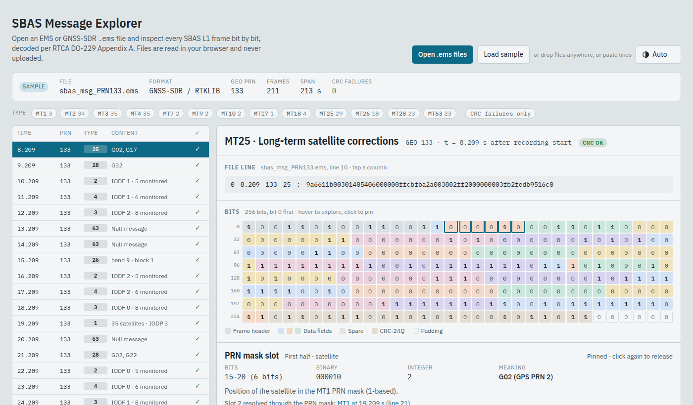

# SBAS Message Explorer

Open an SBAS L1 `.ems` file (GNSS-SDR / RTKLIB or ESA EMS format) and inspect every 250-bit frame bit by bit, decoded per RTCA DO-229 Appendix A: PRN and IGP masks, fast corrections and UDRE, long-term corrections, degradation parameters, GEO navigation and almanac, ionospheric grid delays and GIVE, and more.

Live: https://minhaj6.github.io/sbas-message-explorer/

- Click a message, then hover or click any bit to see its field, raw value, scaled value and meaning.
- Satellite slots and grid points are resolved through the MT1 / MT18 masks in the same file, with a link to the mask message used.
- CRC-24Q is checked on every frame.
- Everything runs in the browser; files are never uploaded.

## Files

| File | Purpose |
|---|---|
| `index.html` | the built page (what GitHub Pages serves) |
| `page.src.html` | page markup, styles and UI code |
| `decoder.js` | parser, CRC and message layouts (also usable from Node) |
| `sample.ems` | sample file behind "Load sample" (WAAS PRN 133, recorded with GNSS-SDR) |
| `build.py` | inlines `decoder.js` and `sample.ems` into `page.src.html` -> `index.html` |
| `test.js` | `node test.js <file.ems>` decodes a file and reports CRC failures |

After editing `page.src.html` or `decoder.js`, run `python3 build.py`.

## Credits

Message layouts follow RTCA DO-229 Appendix A. IGP band geometry follows [RTKLIB](https://github.com/tomojitakasu/RTKLIB). The file-line explanations are inspired by the [gAGE](https://gage.upc.edu) GNSS format descriptions.
